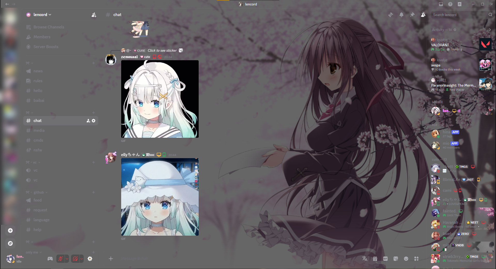

# len's vencord theme

this is a vencord theme that i made for myself, feel free to use it if you want to

it puts your own image as the discord background and makes everything transparent on top of it



## install

**online theme (auto updates)**

1. open discord settings → vencord → themes → online themes
2. paste this link:

```
https://raw.githubusercontent.com/lennmoe/vencord-theme/main/len.theme.css
```

**local theme**

1. download [len.theme.css](len.theme.css)
2. open discord settings → vencord → themes → open themes folder
3. drop the file in there and enable it

## change the background image

the image is set with the `--nvbgimg` variable

**if you use the online theme**, add this to your quickcss (settings → vencord → themes → edit quickcss) and put your own link:

```css
:root {
    --nvbgimg: url("https://your-image-link.png");
}
```

**if you use the local theme**, just edit the `--nvbgimg` line at the top of `len.theme.css`

> use a direct link to the image (it should end in `.png`, `.jpg`, `.gif`…). [postimg](https://postimages.org) or an imgur direct link works fine

## change the darkness

`--nvbgadjust` is a dark layer on top of the image so text stays readable. change the last number (`0` = no darkening, `1` = full black):

```css
:root {
    --nvbgadjust: rgb(0 0 0 / 0.6);
}
```
